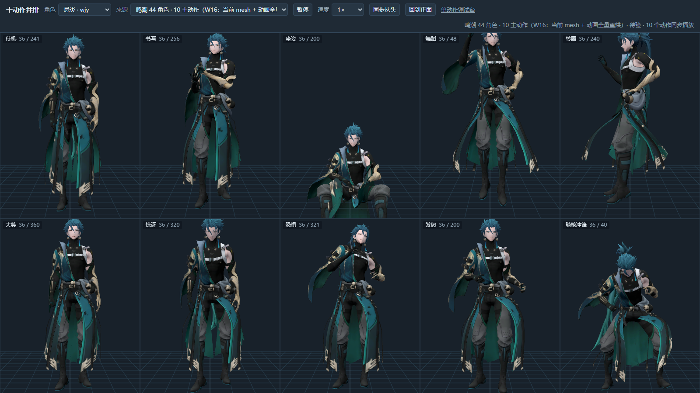
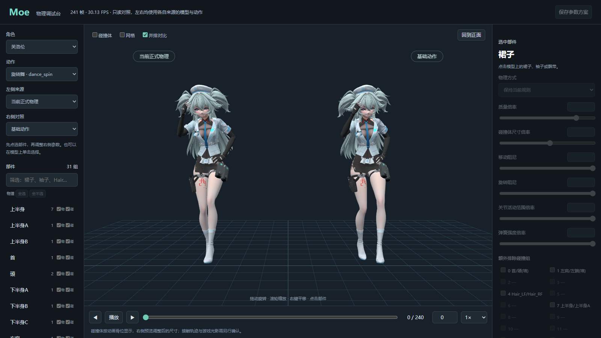

# ck3moe_devTools：CK3 萌化 mod 开发工具包

这是从 CK3 MoeMod 工程里整理出来的“交接包”，只含文本：流水线说明、可直接喂给 AI 助手的任务提示词、踩坑教训、以及真正在用的脚本。不含模型、贴图、烘焙产物、第三方库。

给谁用：要接手或参与这条流水线的合作者，以及帮他干活的 AI 助手。

## 先看这个：动作预览器（网页版）

调物理和查动画问题，最常用的就是它：`tools/physics/open_physics_debug.py`。它在本机起一个只读的小网页服务，用浏览器里的 three.js 直接播放烘焙后的头身动画，头飞了、裙子穿腿、发尾抖动、循环接缝跳变，肉眼一看就知道。排查物理和动画问题时先开它，再去翻数据。

**十动作页 `/grid`**：一个角色的 10 个固定动作（idle、writing、sitting、dance_loop、dance_spin、emotion_laugh、emotion_shock、emotion_fear、emotion_angry_start、jockey_lance_couched_gallop）并排同步播放，十格共用一个视角。顶栏可切角色和来源，可暂停、调速（0.25×/0.5×/1×）、同步从头、回到正面；拖动旋转，滚轮缩放，右键平移。适合批量烘完后一眼扫过 44 个角色。



**单动作调试台 `/`**：一个角色、一个动作，左右分屏对比（当前正式物理对基础动作或试烘历史）。可以逐帧拖动，开关碰撞体和网格显示，按部件显隐，点选裙子、袖子、飘带后调物理方式、参数和碰撞组，并试烘当前动作（只读模式下禁用）。



启动有两种，对应上面两个页面：

```
# 十动作页：鸣潮 44 个新角色。两个环境变量缺一个都会报“角色不在可调试名单”或“找不到 mesh”
MOE_PHYSICS_RESPONSE_TRIAL_VIEW=1 MOE_OUT_ROOT=<含模型的构建根> python tools/physics/open_physics_debug.py --read-only --only-source wuwa_10main --port 8765
# 然后打开 http://127.0.0.1:8765/grid

# 单动作调试台：不要加 --only-source，直接 http://127.0.0.1:8767/?character=flo&action=dance_spin
MOE_PHYSICS_RESPONSE_TRIAL_VIEW=1 MOE_OUT_ROOT=<含模型的构建根> python tools/physics/open_physics_debug.py --read-only --port 8767
```

服务只绑 127.0.0.1，没有账号体系，不要暴露到网络。首次需要 npm 装 three，脚本报错里有命令。

已知限制：
- 单动作调试台的前端（`debug_ui/app.js`）没有登记 `wuwa_10main` 来源，加了 `--only-source wuwa_10main` 再开单动作页会报“动作 … 没有通过头身配对校验”（`/api/actions` 同一参数返回正常，是前端挑目录来源时回落到了 `current`）。鸣潮 44 个角色用 `/grid`，单动作页用正式角色（图里是芙洛伦）。
- 预览器读哪一批结果，写死在 `tools/physics/wuwa_preview.py` 的 `ROOTS`，换批次时要改。

## 先读哪个

1. 本文件（5 分钟）：知道包里有什么、哪些东西跑不起来。
2. `PIPELINE.md`：整条流水线，每一步写了输入、输出、脚本、示例命令、验收判据、常见失败。顺序以代码为准。
3. `prompts/LESSONS_*.md`：五份教训汇总。动手某一阶段之前，只读对应那份。
4. `prompts/00_START_HERE_for_AI.md`：把它连同对应阶段的 `TASK_*.md` 一起贴给 AI 助手。
5. `MANIFEST.md`：每个文件一行，写了原始路径、用途、阶段、外部依赖、硬编码路径。

## 当前状态（务必先看）

工程从 2026-10-07 起改为“直接改 `mod/`，不再用生成器覆盖它”，以创意工坊版本为底。原因：生成器落后于工坊版，`build_moe_mod.py` 开头会清空整个 mod 目录，重建会静默回滚别处已打过的补丁。

所以：

- 不要对一个有人手改过的 `mod/` 跑 `build_moe_mod.py`、`build_all.py` 全流程、`finalize_mods.py`、`publish_mods.py`。
- 可以把输出根指到沙盒目录（环境变量 `MOE_OUT_ROOT`）再跑生成器，出新包后 diff，只并入新角色相关的条目。注意 `finalize_mods.py` 即使传 `--no-sync` 也会改写输出根（替换模型包里的动画文件、写 descriptor），它只能对沙盒运行。
- 只写 `work/` 的脚本（盘点、建网格、烘表情、动画重定向、物理试烘）和只读检查脚本，照常可用。

`PIPELINE.md` 描述的是脚本本身的顺序与依赖，这些顺序在沙盒里仍然成立。

## 这个包本身跑不起来的地方

不是脚本坏了，是缺数据和外部程序。我只做了 import 检查，没有运行任何构建、烘焙或装机。

1. 缺角色盘点数据。`tools/lib/moe_chars.py` 导入时会为一批候选角色读 `work/pmx_skeleton_inventory/<slug>.json`，缺一个就抛 `FileNotFoundError`，于是几乎所有入口脚本都导入失败。这批 JSON 约 9 MB、195 个文件，在原工程的 `work/` 下，没有收进包里。我用占位记录在临时目录里验证过：补齐后，80 个模块可以正常 import（见 `PIPELINE.md` 末尾）。
2. 缺外部程序：Blender 5.2（含 mmd_tools 与打过容差补丁的 io_pdx_mesh）、CK3 本体、物理解算器要 MSVC + CMake + Ninja，并需要第三方库 `third_party/bullet3`。
3. 缺 `build_cam_rig.py`。`tools/build/carrier_pipeline.py` 的第 6 步要调用它。在补上之前不要运行 `carrier_pipeline.py`：它前五步会原地改写模型包，第 6 步才失败，会留下改了一半的包。
4. 缺 `work/` 下的两个脚本：`work/evidence/wuwa_import_20261008/replay_pack_fixes.py` 和 `work/camfix/vnode_fix_all.py`（及 `vnode_postcheck.py`、`vnode_reorder.py`）。它们是新包的必经步骤。`PIPELINE.md` 里写了它们的位置与顺序。

## 硬编码路径

很多脚本写死了盘符，原样保留，没有改写：

- `D:`：Blender 安装路径（`D:\steam\steamapps\common\Blender\blender.exe`）、工程根目录（`lib/moe_bone_contract.py`、`lib/moe_material_contract.py`、两份物理发布配方）。
- `E:`：CK3 安装目录（`.../Crusader Kings III`），十几个脚本读原版游戏文件。
- `E:` / `F:`：`E:` 除了 CK3 安装目录，还在 `open_physics_debug.py` 里写了一批物理证据目录；`F:` 是暂存盘，物理试验的证据根（`*_preview.py` 里 27 个文件写了 `F:` 路径）。
- `C:`：本机用户文档下的 CK3 mod 目录（`build/publish_mods.py`、`build/build_moe_mod.py`），以及 Visual Studio Build Tools 路径（`physics/moe_bullet/build.ps1`）。

逐文件清单见 `MANIFEST.md` 的“依赖”列。换机器时，最小改动是把这些路径集中改成自己的，改完后再 import 检查。

## 目录

```
ck3moe_devTools/
  README.md  PIPELINE.md  MANIFEST.md
  prompts/    00_START_HERE_for_AI.md
              TASK_S1_S2_mesh.md  TASK_S3_expression.md  TASK_S4_animation.md  TASK_S5_textures.md
              TASK_S6_mod_build.md  TASK_S7_physics.md  TASK_S8_carrier.md
              TASK_S9_install_verify.md  TASK_S10_publish.md
              LESSONS_1_model_expression_textures.md  LESSONS_2_animation.md
              LESSONS_3_ck3_mod_gui_shader.md  LESSONS_4_physics.md  LESSONS_5_build_verify_ops.md
  tools/      按流水线阶段分子目录，原样结构
    lib/ anim/ model/ textures/ build/ physics/ render/ verify/
    build_all.py  audit_repo.py
```

`tools/lib` 与 `tools/anim` 必须同时在 `sys.path` 里；每个入口脚本开头都会自己加（形如 `sys.path[:0] = [... for d in ("lib", "anim")]`），根目录用 `Path(__file__).resolve().parents[2]` 推出，所以整个文件夹可以放在任何位置，只要里面保持这个结构。

## 使用约定

- 先问再动：烘焙和装机都很慢，动手前确认当前是不是沙盒、有没有别的任务在占用模型包。
- 脚本不要原地改：有问题改上游那一步，或复制出来改。本包的副本和原工程逐字节一致。
- 教训文件是时间点观察，来源记忆有的已过 50 天，文中标了“已取代”“有张力”的条目，以实机为准。
- 教训条目末尾的“来源记忆：xxx”是原作者私人笔记的文件名，笔记本身不在本包里，当作出处标签即可，不用去找。
